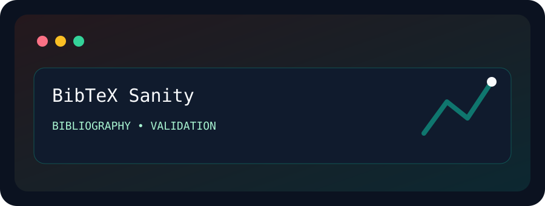

<div align="center">


[](LICENSE)
[](https://www.python.org/)
[](https://github.com/CyberLoop-dev/bibtex-sanity/stargazers)
[](https://github.com/CyberLoop-dev/bibtex-sanity/commits/main)

**A practical, dependency-free validator for BibTeX libraries.**



</div>

## 🧭 Overview

BibTeX Sanity checks local .bib files for duplicate citation keys, missing required fields by entry type, empty values, and malformed entry boundaries. It reports line numbers and can emit JSON for scripts.

## ✨ Features

- 🔎 Detects duplicate citation keys.
- 📚 Checks common required fields for article, book, and inproceedings entries.
- ⚠️ Reports empty fields and malformed entry boundaries.
- 🤖 Offers JSON output for editor or CI integration.
- 🐍 Uses the Python standard library only.

## 🖥️ Demo

```bash
python main.py references.bib
python main.py references.bib --json
```
The report lists each issue with its entry key and source line.

## 🚀 Quick Start

```bash
git clone https://github.com/CyberLoop-dev/bibtex-sanity.git
cd bibtex-sanity
python main.py examples/library.bib
```

## 🧱 Tech Stack

- 🐍 Python 3.10+
- 📦 Standard library: argparse, json, re, pathlib

## 🗂️ Folder Structure

```text
bibtex-sanity/
├── main.py
├── examples/library.bib
├── tests/test_main.py
├── pyproject.toml
├── assets/illustration.svg
├── .gitignore
└── README.md
```

## 🛣️ Roadmap

- - [x] Common BibTeX entry types and required fields
- - [x] Duplicate-key and empty-field checks
- - [ ] Optional strict field-name mode

## 🤝 Contributing

Issues and pull requests are welcome. Please include a clear reproduction or sample input and keep changes focused.

## 📄 License

Released under the [MIT License](LICENSE).

<div align="center">


</div>
